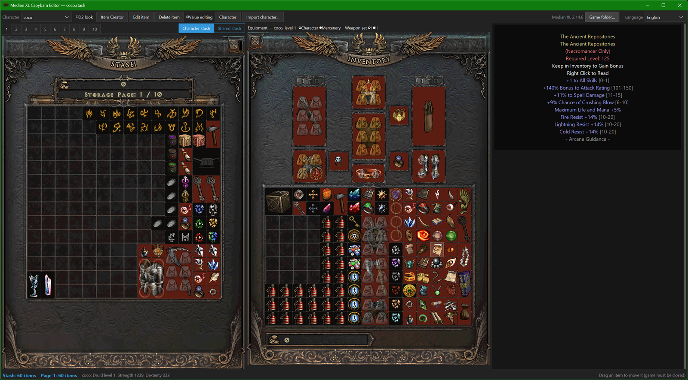

# MXL Capybara Editor

An offline item creator and character editor for **Median XL**, built on top of MXL Item Collector.

## Features
- **Item Creator**: make unique, set, runeword, Angelic, rare, magic, superior or normal items, including mystic orbs and other special misc items.
- **Edit / Delete item**: edit any stash item in the creator and write it back in place. A backup is made before every change.
- **Equipment and inventory next to the stash**: drag items between the stash, the inventory, the equipment slots and the mercenary.
- **Character window** (in the style of the old Hero Editor): stats and level-up, inventory, waypoints and quests for Normal, Nightmare and Hell.
- Safe writes: the game must be closed, every file is verified, and backups are kept.
- Languages: English, French, Vietnamese (`lang/`).

## Install
1. Download `MXL-Capybara-Editor-v1.0.zip` from the [Releases](../../releases) page.
2. Unzip it anywhere and run `MXL Capybara Editor.exe`.
3. Close the game before you save any changes.

## Reporting a problem
The editor keeps a log at `%LOCALAPPDATA%\MXL Item Collector\capybara.log`, which records saves, backups, imports and errors.
Attach it to your bug report, along with the saved character page if the problem is with an import.

## Source
The Python source is in [`src/`](src). The editor is a set of modules added to the MXL Item Collector exe:
`repack.py` rebuilds the PyInstaller exe with these modules included, and `rsrc.py` sets the capybara icon.
See [`docs/DEVELOPER_NOTES.md`](docs/DEVELOPER_NOTES.md) for how each part works.

## License
[MIT](LICENSE). This covers the code in this repository only. MXL Item Collector, the Hero Editor art and the
Median XL game data belong to their respective authors.

## Credits
Hero Editor button art and the window layout come from Hero Editor 1.04 by ZonFire99 and Mastadex. Glory to the real Heroes.
